# EventFinder South Africa

[](https://github.com/Zulfique/eventfinder-south-africa/actions/workflows/android-ci.yml)


A native **Android (Kotlin + Jetpack Compose)** app that helps people across South Africa
discover, save and create local events — from Joburg jazz nights to Cape Town food markets
and Durban festivals.

EventFinder was built as the **Part 2 (final) Portfolio of Evidence** for the module.
It consumes **100% free, keyless REST APIs** and runs on a physical device or emulator.
Cloud features (Firestore sync + FCM push) run on the free **Firebase Spark plan** — no
paid infrastructure; Firebase Storage is optional and falls back to local file storage.

---

## Table of contents

1. [Features](#features)
2. [Screenshots](#screenshots)
3. [Tech stack](#tech-stack)
4. [Architecture](#architecture)
5. [External APIs](#external-apis)
6. [Localisation](#localisation)
7. [Offline-first behaviour](#offline-first-behaviour)
8. [Security](#security)
9. [Getting started](#getting-started)
10. [Testing](#testing)
11. [Continuous integration](#continuous-integration)
12. [Project structure](#project-structure)
13. [Requirement traceability](#requirement-traceability)
14. [Firebase setup](#firebase-setup-free-spark-plan)
15. [Known limitations](#known-limitations)
16. [Attribution & licences](#attribution--licences)

---

## Features

| Area | What it does |
| --- | --- |
| **Discover** | Browse the local event catalogue, filter by category chip and free-text keyword, sort by date / distance / name. |
| **Near me** | Requests location permission and sorts events by distance using the Haversine great-circle formula. |
| **Map** | Event locations plotted on a free OpenStreetMap map (osmdroid) — no Google Maps key or billing. |
| **Event detail** | Hero image, organiser, attendee count, venue map link, **weather forecast at the venue** on the event day, share and RSVP. |
| **Search** | Debounced keyword search with recent-search history and popular events. |
| **Create event** | A 3-step wizard (details → date/time → location) with an optional photo picked from the system photo picker. |
| **My events** | Organisers can edit or delete the events they created from the detail screen's overflow menu. |
| **Favourites** | Save events offline; favourites survive app restarts and are stored in the local Room catalogue. |
| **Profile** | Activity stats (created / attending / favourites), My Events and Attending lists. |
| **Edit profile** | Update display name and email with validation. |
| **Settings** | Language switch (English / Afrikaans), event reminders, new-event alerts, plus account tools (clear local cache, delete account). |
| **Reminders** | `AlarmManager` + `NotificationChannel` reminders **24 hours and 1 hour** before an attended event, cancelled when the RSVP is declined. |
| **Event alerts** | On-device notifications flag newly added or changed events in the local Room catalogue — computed by a pure diff, no push service required. |
| **Cloud sync** | User-created events, favourites and RSVPs sync bidirectionally with **Cloud Firestore** (NoSQL) — automatically, whenever connectivity returns. |
| **Real-time push** | **Firebase Cloud Messaging** delivers live updates to the `new_events` topic; devices auto-subscribe on launch. |
| **Blob storage** | Event photos upload to **Firebase Cloud Storage**; when Storage is unavailable (requires Blaze billing) they are stored in local internal file storage instead — nothing breaks. |

## Screenshots

Every screen below was captured from the running app on an Android 14 (API 34)
emulator at 1080 × 2340.

| Login | Register | Forgot password | Home (Discover) |
| :---: | :---: | :---: | :---: |
| 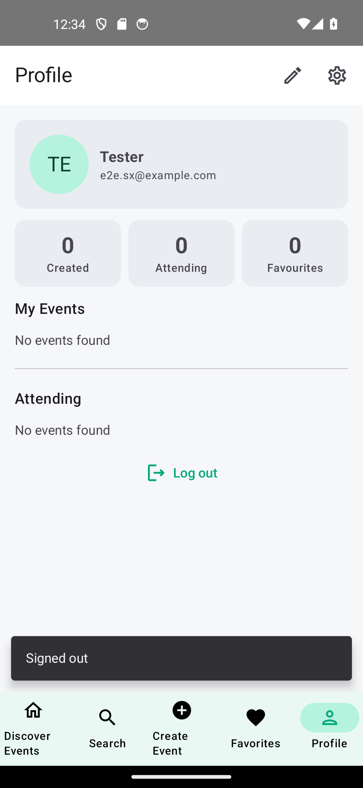 | 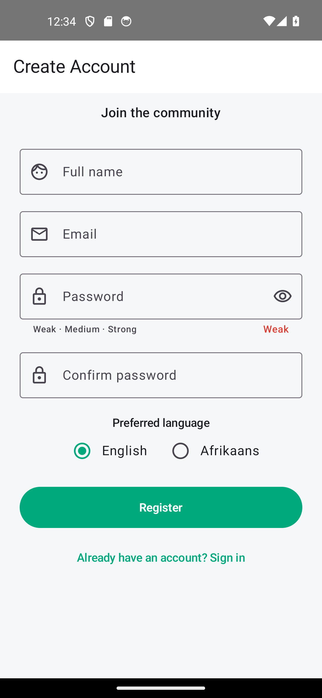 | 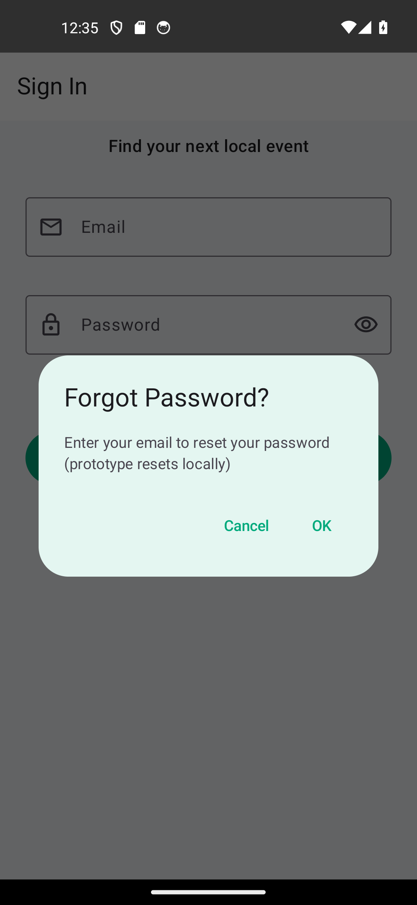 |  |

| Event detail | Map | Favourites | Search |
| :---: | :---: | :---: | :---: |
| 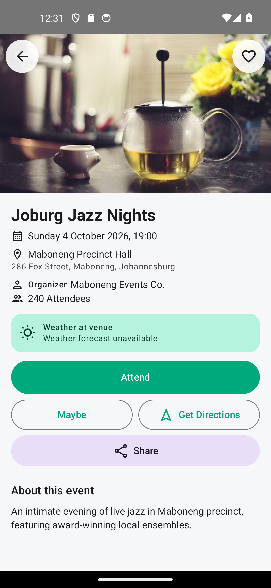 | 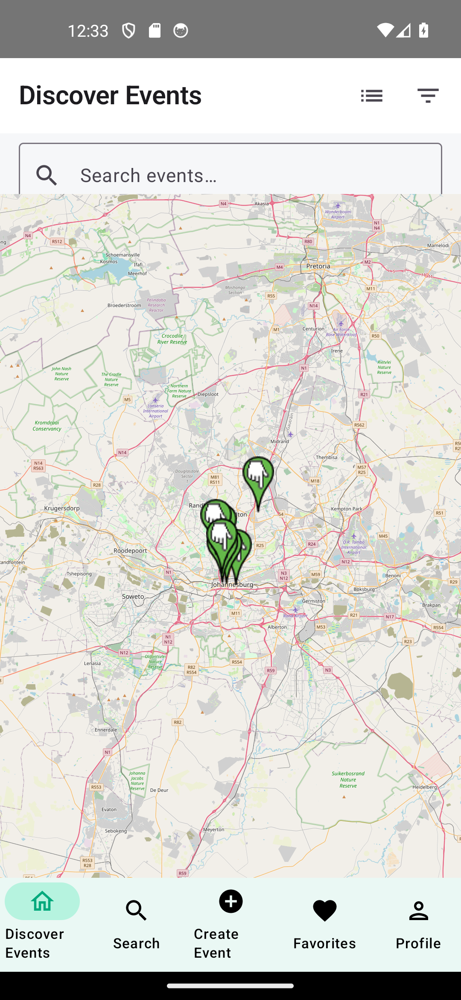 |  |  |

| Create – details | Create – date & venue | Date picker | Create – review |
| :---: | :---: | :---: | :---: |
| 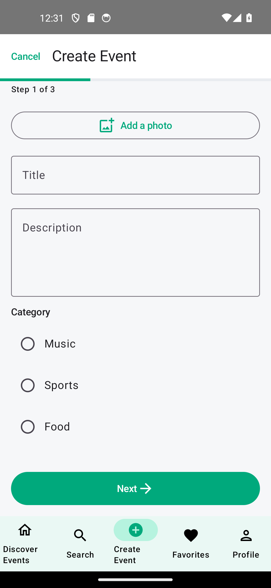 | 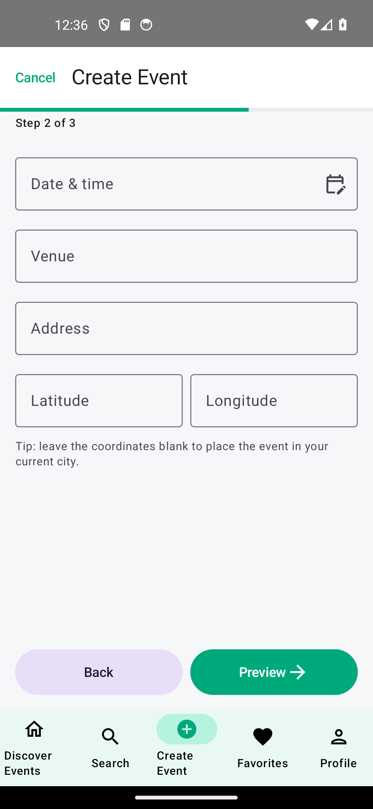 | 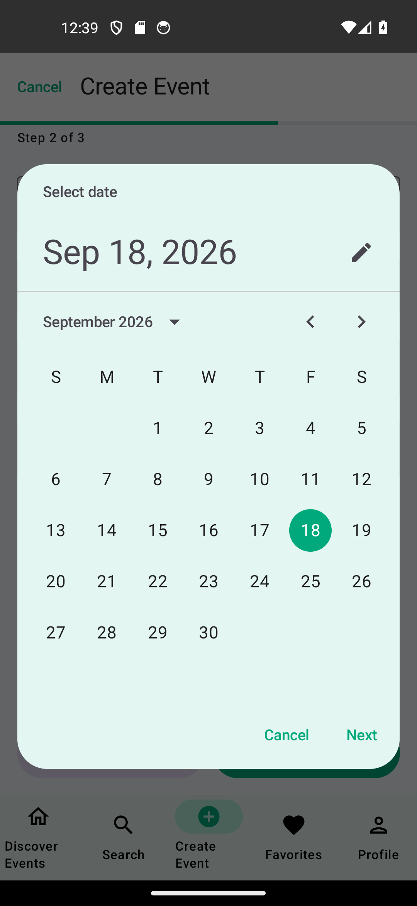 | 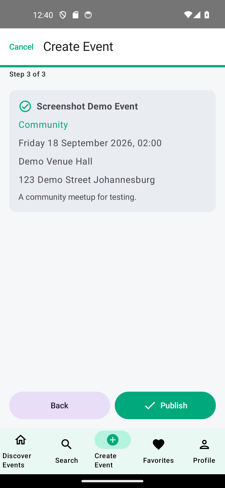 |

| Profile | Edit profile | Settings |
| :---: | :---: | :---: |
| 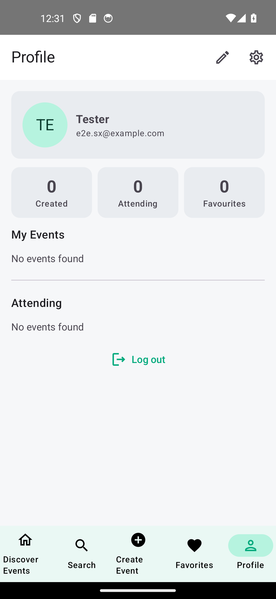 | 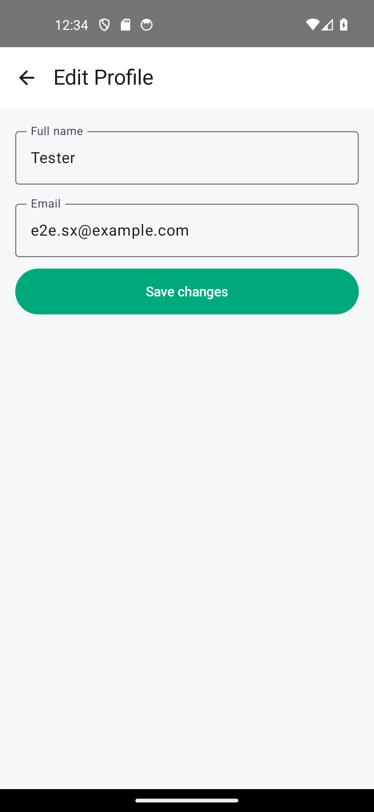 |  |

## Tech stack

| Layer | Choice | Why |
| --- | --- | --- |
| Language | **Kotlin 1.9.22** | First-class Android language, coroutines, null-safety. |
| UI | **Jetpack Compose** (BOM 2024.02, Material 3) | Declarative UI, single activity, no XML layouts. |
| Architecture | **MVVM + Repository** | Testable, unidirectional data flow (`StateFlow`). |
| DI | **Manual `AppContainer`** | Transparent, dependency-free alternative to Hilt for a prototype. |
| Local DB | **Room 2.6.1** | Compile-time verified SQLite for the offline event cache. |
| Cloud NoSQL | **Cloud Firestore** | Bidirectional sync of user-created events, favourites and RSVPs. Free Spark plan, owner-scoped secure rules + anonymous auth. |
| Backend | **ASP.NET Core 8 Minimal API** (`api/`) | Verified auth (register / login / Google), two-step password reset, public event catalogue, multi-user RSVP. EF Core + SQLite, deploys on Render free tier. |
| Google sign-in | **AndroidX Credential Manager** | Returns a Google ID token verified server-side (audience + signature) before a JWT is issued. |
| Blob storage | **Firebase Cloud Storage** | Event photos stored as blobs; graceful fallback to local internal storage when Storage is not enabled (requires Blaze). |
| Push notifications | **Firebase Cloud Messaging** | Real-time `new_events` topic pushes; free, no server needed for console sends. |
| Preferences | **DataStore Preferences 1.0** | Async, type-safe key/value storage for settings & session. |
| Networking | **Retrofit 2.9 + OkHttp 4.12 + Gson** | Industry standard REST client with logging interceptor. |
| Images | **Coil 2.6** | Coroutine-friendly Compose image loading. |
| Maps | **osmdroid 6.1.18** | Free OpenStreetMap tiles, no API key, no billing. |
| Security SDK | **AndroidX Biometric 1.1** | Fingerprint / face unlock. |
| Build | **AGP 8.2.2, Gradle 8.7, JDK 17** | Current stable toolchain. |
| Tests | **JUnit 4 + kotlinx-coroutines-test** | Pure JVM unit tests, no device required. |

## Architecture

EventFinder follows a clean three-layer **MVVM** architecture. The UI layer never talks to
Retrofit or Room directly — everything flows through repositories that hide the data sources.

### Layered overview

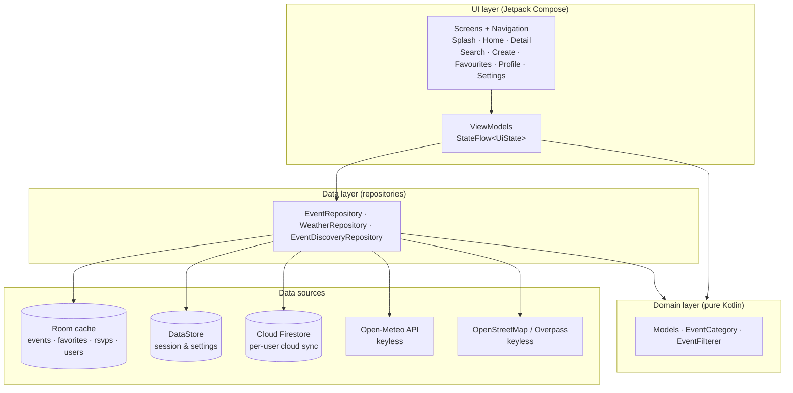

### Venue discovery flow

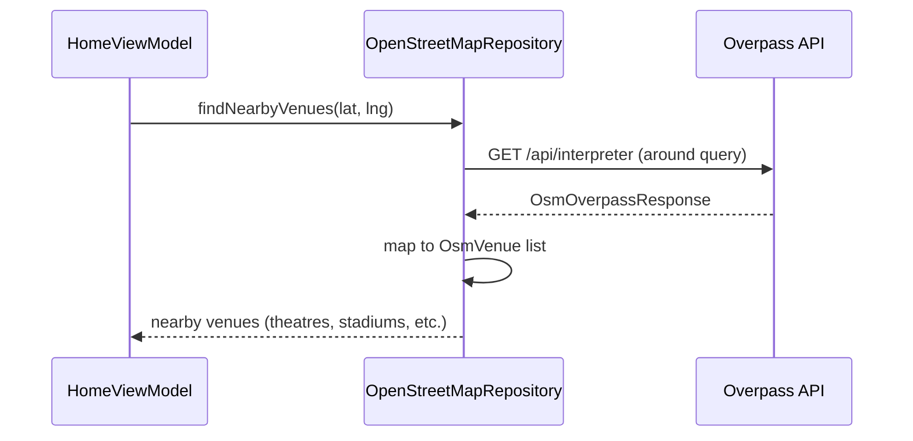

### Navigation graph

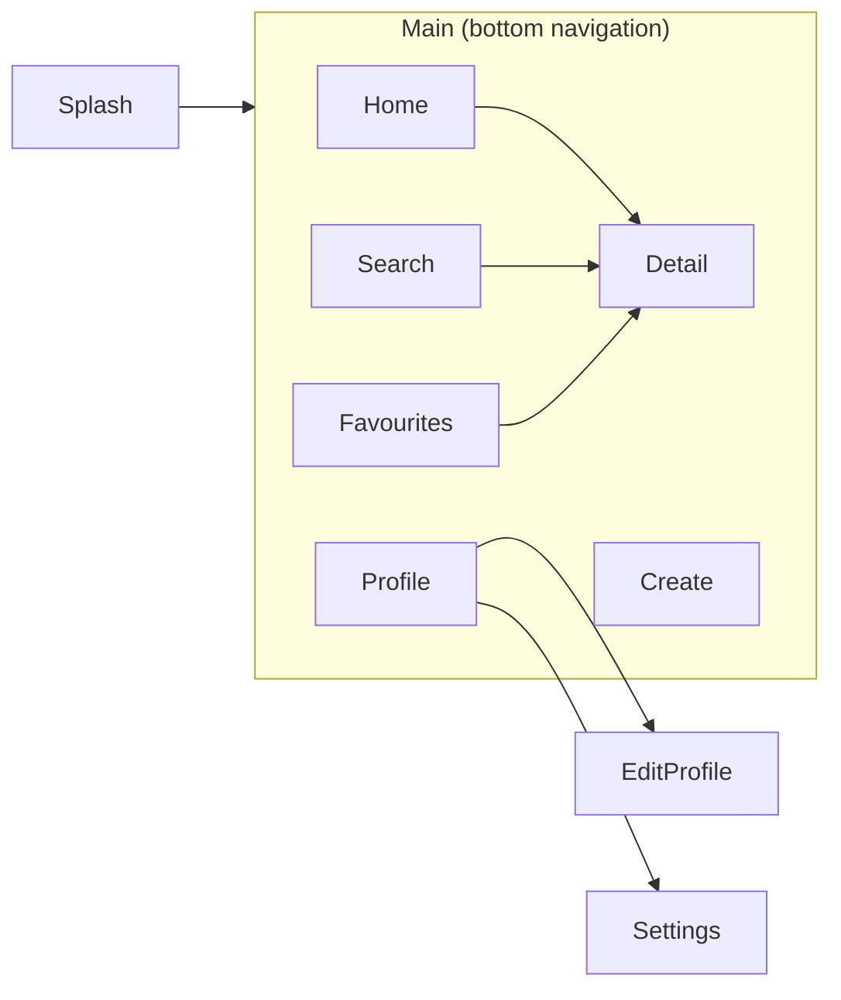

## External APIs


EventFinder uses public services that do not require API keys or tokens:

| Service | Auth | Used for |
| --- | --- | --- |
| **Open-Meteo** | Keyless | Weather forecasts |
| **OpenStreetMap** | Keyless | Map data |
| **Overpass API** | Keyless for normal OSM data queries | Nearby venues and event-related places |
| **Ardent Africa** | Keyless (optional API key for higher limits) | Public event discovery |
| **Android Location APIs** | Device permission | Current device location |
| **Room / SQLite** | Local | Events, users, favourites and RSVPs |

### OpenStreetMap / Overpass

Overpass is used to discover nearby event-related places such as:

- theatres
- cinemas
- arts centres
- museums
- galleries
- stadiums
- sports centres
- community centres
- conference centres
- attractions
- theme parks
- zoos

Overpass provides OpenStreetMap objects rather than a commercial event calendar.
Therefore OSM venue discovery does not fabricate event dates or scheduled performances.

Actual scheduled EventFinder events are stored locally in Room and may be created by
the user.

OpenStreetMap data is © OpenStreetMap contributors.

OpenStreetMap requires appropriate attribution when using its data.

### Public JSON event feeds

EventFinder can discover real-world events from keyless public JSON feeds. The pipeline works as follows:

1. Each `EventSource` implementation fetches events from its endpoint.
2. `PublicJsonEventMapper` normalises different JSON schemas into a common `RemoteEvent` model.
3. `EventDiscoveryRepository` validates each event (future-only, valid coordinates, non-blank title).
4. Valid events are upserted into Room with `remote:` prefixed IDs to prevent collisions with user-created events.
5. Events without valid coordinates are rejected since they cannot be plotted on the map.

Currently configured sources:

| Source | URL | Key required |
| --- | --- | --- |
| **Aticket South Africa** | `https://za.aticket.net/feed/featured-events` (RSS) | No |
| **Motorsport South Africa** | `https://www.motorsport.co.za/events/list/?ical=1` (ICS) | No |
| **Ardent Africa** | `https://api.ardent.africa/public/v1/events` (JSON) | No |

New sources can be added in `SouthAfricaEventSources.kt` without changing any other code.
The `PublicJsonEventClient` handles `{ "events": [...] }`, `{ "data": [...] }`, `{ "results": [...] }`,
and bare JSON array formats automatically. RSS and ICS sources are parsed by `RssEventSource` and
`IcsEventSource` respectively.

## Localisation

The whole UI is externalised to string resources and ships in two languages:

- `res/values/strings.xml` — **English**
- `res/values-af/strings.xml` — **Afrikaans**

The language is switched at runtime from **Settings** (persisted in DataStore) and applied
through `LocaleManager` in `MainActivity.attachBaseContext`.

## Offline-first behaviour

- Events, favourites and RSVPs are cached in **Room** and observed as `Flow`s, so the UI renders instantly.
- Favourite, RSVP and event mutations are wrapped in **atomic `@Transaction` boundaries** for consistency.
- **`SyncCoordinator`** watches connectivity: on every offline → online transition it triggers a Firestore sync (`syncNow()`) and a public-feed refresh, then pushes local mutations made while offline.
- The app attempts to discover public JSON event feeds when online; discovery failure never blocks the local catalogue.
- Reminder alarms carry the owning `userId` and `ReminderReceiver` verifies the active session before posting, preventing stale-account notifications.
- The UI never blocks on the network: a failed discovery simply keeps the cached catalogue.

## Security

- Credentials never leave the device. `local.properties` and keystores are git-ignored.

## Getting started

### Prerequisites

- **Android Studio Hedgehog** (or newer) or the Android command-line tools
- **JDK 17** (`JAVA_HOME` must point at it — AGP 8.x does not support JDK 21)
- Android SDK with **API 34** platform + build-tools
- A physical device or emulator running **API 26+**

### 1. Clone

```bash
git clone https://github.com/Zulfique/eventfinder-south-africa.git
cd eventfinder-south-africa
```

### 2. Configure the SDK path

Create `local.properties` in the project root (git-ignored):

```properties
sdk.dir=C\:\\Users\\<you>\\AppData\\Local\\Android\\Sdk
```

### 3. API keys & Firebase config

EventFinder requires **no API keys** for its REST integrations — Open-Meteo,
OpenStreetMap/Overpass and the public event feeds are all keyless. No developer accounts
or secrets are embedded in the APK.

The only cloud config is `app/google-services.json`, a **public Firebase app identifier**
(no secret) that ships in the repo pointing at the live `eventfinder-south-africa` project.
Every Firebase call checks `FirebaseStatus` first and degrades to offline-only Room
behaviour when Firebase is unreachable, so the app works with the config removed entirely.
See [Firebase setup](#firebase-setup-free-spark-plan) to point it at your own project.

Google sign-in and the REST backend are configured via Gradle properties (all optional —
the app falls back to purely local auth when they are blank):

```properties
# local.properties (gitignored) — used by app/build.gradle.kts
GOOGLE_SERVER_CLIENT_ID=<OAuth web client ID from Google Cloud console>
EVENTFINDER_API_URL=https://eventfinder-api.onrender.com/
```

### 4. Build & install

```bash
# Linux / macOS / Git Bash
./gradlew assembleDebug
adb install -r app/build/outputs/apk/debug/app-debug.apk

# Windows (PowerShell)
$env:JAVA_HOME="C:\Program Files\Java\jdk-17"
.\gradlew.bat assembleDebug
adb install -r app\build\outputs\apk\debug\app-debug.apk
```

## Testing

The project has **159 JVM unit tests** across 18 suites, all runnable from the command line with
no emulator:

```bash
./gradlew testDebugUnitTest
```

| Suite | Covers |
| --- | --- |
| `ValidatorsTest` | Email, password strength, name and the multi-field registration form. |
| `PasswordHasherTest` | PBKDF2 hashing, salting, verification and fail-closed behaviour on malformed values. |
| `DistanceCalculatorTest` | Haversine distance, symmetry, rounding and radius checks. |
| `EventFiltererTest` | Keyword / category / radius filtering (including address and description matching), three sort orders, distance attachment. |
| `WeatherRepositoryTest` | WMO weather-code descriptions and Open-Meteo payload handling. |
| `OpenStreetMapRepositoryTest` | Overpass venue query mapping and geographic bounding. |
| `EventRepositoryTest` | Seeding, favourite/RSVP toggling, event creation, editing/deleting with ownership guard, cache clearing — using in-memory DAO fakes. |
| `SampleEventsProviderTest` | Demo catalogue integrity (unique ids, valid SA coordinates, sane dates). |
| `CreateEventValidationTest` | Per-step wizard validation (required title/description, future date, venue, coordinate ranges) that drives the inline error messages. |
| `EventAlertDetectorTest` | Pure new-event / favourite-changed diffing, including quiet first sync and past-event suppression. |
| `DateTimeUtilsTest` | Relative date helpers (today/tomorrow, day & hour offsets) and stable date formatting. |
| `LoginViewModelTest` | Two-step backend password reset (send token, confirm token, mismatch, weak password, blank token) with a fake repository. |
| `EventDiscoveryRepositoryTest` | Event discovery pipeline: valid future events inserted, missing coordinates rejected, past events rejected, source failures handled gracefully, deduplication by stableId, multi-source merging. |
| `PublicJsonEventMapperTest` | Public JSON event DTO parsing: Ardent Africa string-location handling, object-location parsing, null-location graceful handling, mapper output validation. |
| `RssEventSourceTest` | RSS date parsing: `start_time` / `event_date` / plain `<start>` / `dc:date` / `<when>` element variants, and items carrying only a publication date being ignored. |
| `EventGeocoderTest` | Reverse-geocoding results accepted only when they resolve inside South Africa (full country name, country code, mixed results; non-SA rejected). |
| `ReminderScheduleTest` | Reminder offsets: 24 h + 1 h lead times, same-day events, events starting within the hour, past events, and boundary-exact leads. |
| `CloudSyncMappingTest` | Firestore document ↔ domain mapping for events, favourites and RSVPs used by `CloudSyncManager`. |

HTML reports are written to `app/build/reports/tests/testDebugUnitTest/index.html`.

### Instrumented UI tests

A small **Compose UI test** suite runs on a connected device/emulator and covers the shared
widgets (`app/src/androidTest/.../ui/components/CommonComponentsTest.kt`):

```bash
./gradlew connectedDebugAndroidTest
```

| Test | Covers |
| --- | --- |
| `eventCard_displaysTitleAndVenue` | Card renders the event title, venue and metadata. |
| `eventCard_clickInvokesCallback` | Tapping the card fires its `onClick`. |
| `eventCard_favouriteToggleInvokesCallback` | The heart button reports add/remove from its content description. |
| `categoryChips_selectsACategoryAndCanClearIt` | Category chips select and clear the filter. |
| `categoryChips_selectsTheActiveChip` | The active category exposes selected semantics; the others do not. |
| `emptyState_displaysTitleAndSubtitle` | The reusable `EmptyState` renders its icon, title and subtitle. |

## Continuous integration

GitHub Actions runs on every push / PR to `main` (`.github/workflows/android-ci.yml`) as two jobs:

**1. Build & unit test** (`ubuntu-latest`)

1. Validate the Gradle wrapper
2. Set up **JDK 17** + Gradle build cache
3. `./gradlew testDebugUnitTest`
4. `./gradlew lintDebug`
5. `./gradlew assembleDebug`
6. Upload the unit test report and the debug APK as build artifacts

**2. Instrumentation tests** (after job 1 passes)

1. Boot an **API 33 x86_64 emulator** (KVM enabled)
2. `./gradlew connectedDebugAndroidTest`
3. Upload the instrumentation report

CI never depends on a secret to compile — all external APIs are keyless, and the checked-in
`google-services.json` is a public app identifier.

## Project structure

```
app/src/main/java/com/eventfinder/app/
├── data/
│   ├── cloud/          FirebaseStatus, CloudSyncManager, FirebaseImageUploader, SyncCoordinator, TaskAwait
│   ├── local/          Room entities, DAOs, database + entity↔domain mappers
│   ├── remote/         Retrofit services, DTOs, API client (Open-Meteo + Overpass + public JSON + EventFinder backend)
│   ├── remote/dto/     Public JSON event DTOs with multi-format field resolution
│   ├── remote/model/   Provider-independent RemoteEvent model
│   ├── repository/     Event / Auth / Weather / Discovery repositories + sample seed data
│   ├── sources/        EventSource interface, PublicJsonEventSource, mapper, South Africa config
│   └── store/          DataStore user preferences
├── di/                 AppContainer (manual dependency injection)
├── domain/model/       Event, User, RSVP, categories, filter/sort engine
├── notifications/      Notification helper, reminders, boot receiver, FCM messaging service
├── security/           Biometric authentication wrapper + GoogleSignInHelper (Credential Manager)
├── ui/
│   ├── components/     Shared Compose components + UiMessage
│   ├── navigation/     NavHost + bottom navigation
│   ├── screens/        splash · auth · home · detail · search · create · favorites · profile · editprofile · settings
│   └── theme/           Material 3 colour scheme & typography
└── utils/              Logging, date/time, distance, validation, hashing, locale, network
app/src/test/java/com/eventfinder/app/   JVM unit tests
app/src/androidTest/java/com/eventfinder/app/   Compose instrumented UI tests
api/EventFinder.Api/                     ASP.NET Core 8 backend (Minimal API + EF Core + SQLite)
api/EventFinder.Api.Tests/               13 xUnit integration tests (WebApplicationFactory)
render.yaml                              Render free-tier deploy blueprint (Docker)
docs/screenshots/                        Real device screenshots
```

## Requirement traceability

| Requirement | Where it is implemented |
| --- | --- |
| RESTful API integration | Open-Meteo, OpenStreetMap/Overpass (keyless) **and** the ASP.NET Core EventFinder backend (`EventFinderApiClient`) |
| External library integration | Room, Retrofit/OkHttp, DataStore, Coil, osmdroid, AndroidX Biometric, Credential Manager, Firebase |
| Native Android SDK integration | `AlarmManager` + `NotificationManager` reminders, `LocationManager`/location permissions, biometrics |
| Offline-first / robustness | Room cache + local event catalogue, graceful fallbacks, validation on every form |
| **Blob storage** | `FirebaseImageUploader` - uploads to Firebase Cloud Storage; falls back to local internal file storage when Storage is unavailable (requires Blaze) |
| **NoSQL database (store)** | `CloudSyncManager.pushLocalChanges` — Firestore writes for events, favourites, RSVPs |
| **NoSQL database (read)** | `CloudSyncManager.pullRemoteChanges` — Firestore reads merged into Room |
| **Biometric authentication** | `security/BiometricAuth.kt` — AndroidX BiometricPrompt, BIOMETRIC_STRONG |
| **Offline mode + auto-sync** | `SyncCoordinator` — offline→online transition triggers Firestore sync + feed refresh |
| **Real-time notifications (FCM)** | `EventFinderMessagingService` + `new_events` topic auto-subscription |
| **Multi-language (2 SA languages)** | English + Afrikaans (`values-af/strings.xml`), `LocaleManager`, in-app switcher |
| **Production assets** | Adaptive launcher icon (SA-flag colours), Material 3 theming, screenshot set |
| **Play Store preparation** | Signed release build (`keystore.properties`), minify + ProGuard, `bundleRelease` ready |
| **CI/CD (GitHub Actions)** | `.github/workflows/android-ci.yml` — build, 159 unit tests, lint, instrumentation on every push |
| Unit testing | 159 JVM tests + 13 API integration tests + 6 Compose instrumented tests + GitHub Actions CI |
| Logging & comments | `AppLogger` used across data/UI layers; KDoc on every class |
| Documentation | This README with Mermaid architecture diagrams |
| **Final POE tag** | Git tag `Final-POE` marks the submission commit |

## Backend (ASP.NET Core 8)

`api/EventFinder.Api` is a free-tier Minimal API that turns the prototype into a real
multi-user product while staying 100% free:

| Capability | Detail |
| --- | --- |
| Stack | ASP.NET Core 8, EF Core 8 + SQLite, JWT bearer auth, xUnit integration tests |
| Auth | Register / login / Google (ID-token verified via `oauth2.googleapis.com/tokeninfo`), change password, profile update (`PUT /api/auth/me`), account deletion (`DELETE /api/auth/me`), `/me` |
| Password reset | Two-step: `forgot-password` emails a SHA-256-hashed, single-use 60-minute token (Brevo free 300/day); missing Brevo key fails visibly instead of logging the token → `reset-password` |
| Events | Public catalogue (`GET /api/events/public`) with city + Haversine radius filters, owner-guarded CRUD |
| RSVP | Multi-user: anyone signed in can RSVP/cancel; `GET /api/events/{id}/attendees` returns the shared list |
| Envelope | Every response is `{ success, message, data, errors }` with server-generated IDs |
| Health | `GET /health` → 200; wired as the Render health check |
| Deploy | `render.yaml` blueprint (Docker, free web tier), `Dockerfile`, auto-migrate on boot |

Run it locally:

```bash
dotnet tool restore                       # dotnet-ef from repo-root manifest
dotnet run --project api/EventFinder.Api  # http://localhost:5078
dotnet test api/EventFinder.Api.Tests     # 13 integration tests
```

The Android app uses Room as its offline source of truth and prefers the API when it is
reachable (auth, create/update/delete, RSVP, discovery merge with `api:`-prefixed ids),
falling back to purely local behaviour when offline. See `api/README.md` for the full
endpoint reference.

## Firebase setup (free Spark plan)

EventFinder uses three Firebase services. Firestore and Cloud Messaging run on the free
**Spark plan** — no credit card required. The `api_key` inside `google-services.json` is a
**public app identifier** issued by Google (the same kind of value that ships in every Android
app), not a secret.

| Service | POE requirement | Plan / limits |
| --- | --- | --- |
| **Cloud Firestore** | NoSQL database (store + read) | Spark (free): 1 GiB storage, 50 K reads / 20 K writes per day |
| **Cloud Messaging** | Real-time push notifications | Spark (free): unlimited message volume |
| **Cloud Storage** | Blob storage | **Requires Blaze billing** (Google policy change). The app degrades gracefully to local internal file storage via `FirebaseStatus` when Storage is unavailable — event photos still work offline on-device. |

### Project status

This repository is wired to a live Firebase project:

- **Project ID:** `eventfinder-south-africa`
- **Android package:** `com.eventfinder.app`
- **Firestore:** enabled (`nam5`); **anonymous authentication** on; owner-scoped security rules
  (`request.auth.uid == userId`) — the app signs in anonymously before syncing and keys every
  document path by the Firebase auth uid
- **FCM:** enabled; devices auto-subscribe to the `new_events` topic
- **Storage:** not enabled (requires Blaze). `FirebaseImageUploader` falls back to local storage.
- **Google sign-in:** an OAuth **web client ID** is required in `local.properties`
  (`GOOGLE_SERVER_CLIENT_ID`); until it is set the Google button stays hidden.

### Connecting your own project

Every Firebase call checks `FirebaseStatus` first and degrades to offline-only Room behaviour
when Firebase is uninitialised, so nothing crashes. To point the app at your own Firebase
project:

1. Go to <https://console.firebase.google.com> → **Add project** (Spark plan, free).
2. **Add an Android app** with package name `com.eventfinder.app`.
3. Download the generated `google-services.json` and replace `app/google-services.json`.
4. Enable **Authentication → Anonymous** and **Firestore Database** (production mode + the
   owner-scoped rules below). Cloud Messaging is on by default. Storage is optional
   (requires Blaze).
5. (Optional) **Authentication → Sign-in method → Google** + **Google Cloud console →
   Credentials → OAuth 2.0 Client IDs (Web application)** → copy the web client ID into
   `local.properties` as `GOOGLE_SERVER_CLIENT_ID`.
6. Rebuild and run on your physical device.

Firestore security rules — each user can only touch their own documents, and only while
authenticated (anonymous sign-in is free on the Spark plan):

```
rules_version = '2';
service cloud.firestore {
  match /databases/{database}/documents {
    match /users/{userId}/{document=**} {
      allow read, write: if request.auth != null && request.auth.uid == userId;
    }
  }
}
```

### Sending a real-time push

1. Firebase console → **Cloud Messaging** → **Send your first message**.
2. Set the topic to `new_events` (the app auto-subscribes every install to this topic).
3. Provide a title and body; every device with the app installed receives the notification.

### Release signing (Play Store)

The release build is signed with the keystore described in `keystore.properties`
(gitignored — never commit it). To reproduce or re-sign:

```
keytool -genkeypair -v -keystore eventfinder-release.jks -alias eventfinder \
  -keyalg RSA -keysize 2048 -validity 10000
cp keystore.properties.example keystore.properties   # fill in your passwords
./gradlew assembleRelease                            # signed AAB-ready APK
./gradlew bundleRelease                              # Play Store upload bundle
```

**Back up `eventfinder-release.jks` and `keystore.properties` somewhere safe** — losing
them means you can never update the published app.

## Known limitations

- **RSVP attendee management** — attendee lists are now shared multi-user via the backend
  (`GET /api/events/{id}/attendees`); there is still no organiser approve/reject workflow.
- **Google sign-in** needs an OAuth web client ID (`GOOGLE_SERVER_CLIENT_ID`) and a Firebase
  project with Google sign-in enabled; the button is hidden until configured.
- **Firebase Cloud Storage** requires the Blaze plan (item 21) — event photos use local
  internal storage fallback, or can be served by the API itself.
- **Render free tier** — the backend sleeps after ~15 min idle (30–60 s cold start); the SQLite
  file lives on ephemeral disk and can reset on redeploy (use a persistent disk or managed DB
  for durable user data).
- **Password reset email** requires a Brevo API key in production (`Brevo__ApiKey`); without it
  `forgot-password` returns a controlled 502 and the service never logs raw tokens.
- **Public event feeds** — the architecture supports keyless public JSON, RSS and ICS event
  sources via `EventDiscoveryRepository`. Aticket South Africa (RSS), Motorsport South
  Africa (ICS) and Ardent Africa (JSON) are configured as verified sources. Events without
  valid coordinates are correctly rejected since they cannot be plotted on the map.
  Additional sources can be added to `SouthAfricaEventSources.kt`.
- **isPublic** events created in the app are pushed to the backend catalogue, so any signed-in
  user discovers them through `GET /api/events/public` (merged into Room with `api:` ids).

## Attribution & licences

- Weather data by **Open-Meteo.com** (CC-BY 4.0).
- Map data © **OpenStreetMap** contributors.
- Venue discovery powered by the **Overpass API** (ODbL).
- Haversine formula adapted from [Moveable Type Scripts](https://www.movable-type.co.uk/scripts/latlong.html) by Chris Veness.
- Password hashing guidance from the [OWASP Password Storage Cheat Sheet](https://cheatsheetseries.owasp.org/cheatsheets/Password_Storage_Cheat_Sheet.html).
